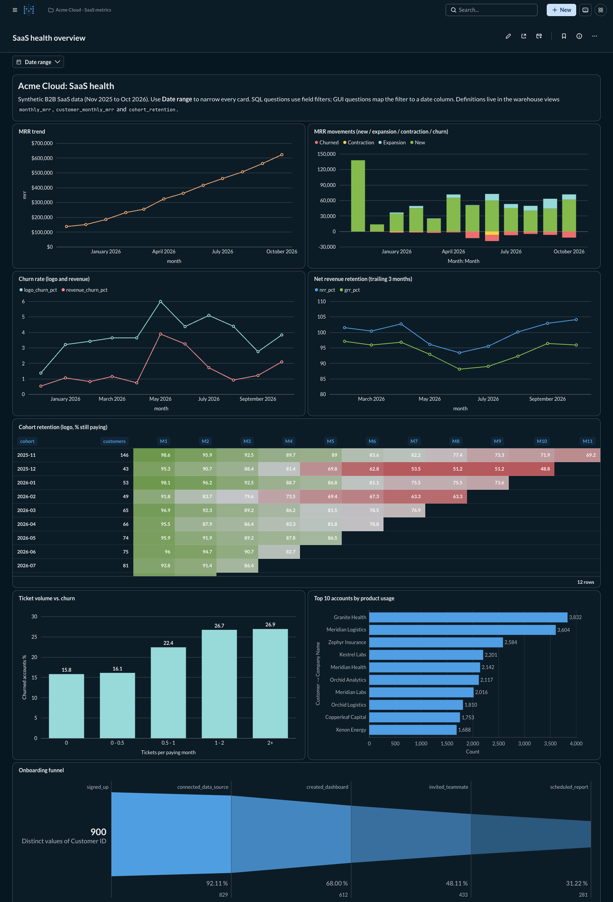
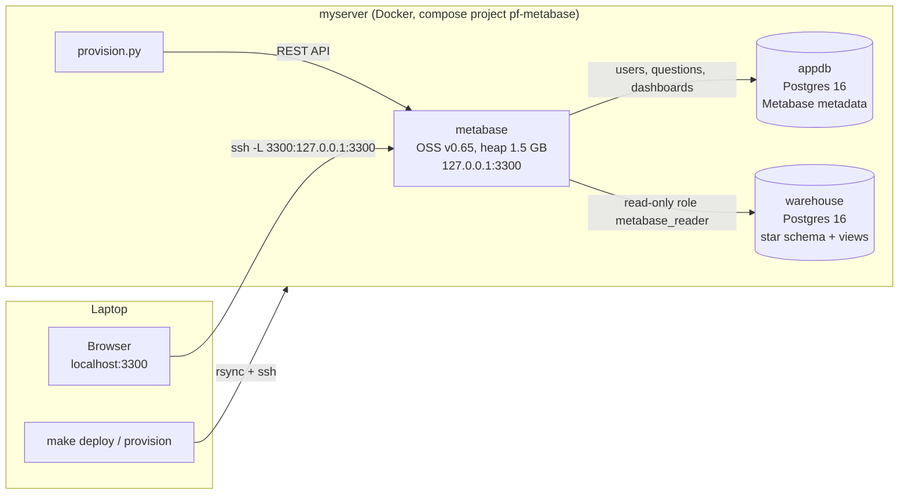
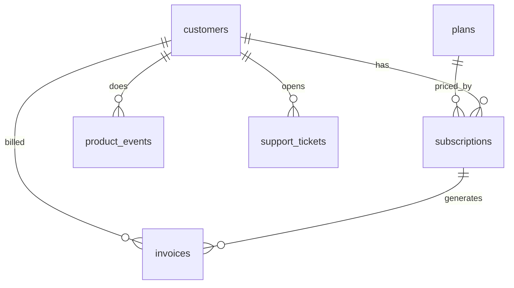

# metabase-saas-analytics

A Metabase deployment you can rebuild from one command. It answers the questions a B2B SaaS leadership team asks every month: MRR, churn, net revenue retention, cohorts, support load and product adoption.

Live demo: <TBD> (runs privately on a VPS; reach it through an SSH tunnel)



## Problem and context

"Acme Cloud" is a fictional per-seat SaaS company. Its data sits in a Postgres warehouse: customers, subscriptions, invoices, product events and support tickets. Leadership wants one dashboard that answers:

| Business question | Card | Built as |
|---|---|---|
| Is recurring revenue growing? | MRR trend | Native SQL on view `monthly_mrr` |
| Where does growth come from (new vs. expansion vs. churn)? | MRR movements | GUI (MBQL) question on the view |
| How many customers and how much revenue do we lose each month? | Churn rate (logo and revenue) | Native SQL |
| Do existing customers grow faster than they leave? | Net revenue retention (trailing 3 months) | Native SQL, self-join |
| Do newer cohorts retain better than older ones? | Cohort retention | Native SQL pivot on view `cohort_retention` |
| Do accounts that file more tickets churn more? | Ticket volume vs. churn | Native SQL |
| Where do new accounts drop out of onboarding? | Onboarding funnel | GUI question, distinct count |
| Which accounts use the product most? | Top 10 accounts by usage | GUI question with an implicit FK join |

One **Date range** filter on the dashboard is wired to all eight cards. Native SQL cards use field filters; GUI cards map the filter straight to a date column.

## Architecture



- **warehouse**: Postgres 16. The init scripts in `warehouse/` create the schema, about 150k rows of deterministic synthetic data, the indexes, three views and a read-only role. It has no published port.
- **appdb**: Postgres 16, used only as Metabase's application database.
- **metabase**: OSS image, pinned to `v0.65.2.5` (the latest release when this was built; override with `MB_VERSION`). It is published on `127.0.0.1:3300` only.
- **provision.py**: uses only the Python standard library to drive the Metabase API. It runs setup, connects the database, creates the questions and dashboard, and then checks the result.

### Data model



Views (the metric layer in SQL): `customer_monthly_mrr` holds MRR per customer at each month end. `monthly_mrr` is the MRR bridge (new / expansion / contraction / churned). `cohort_retention` holds logo retention by signup cohort.

## Quickstart

Requirements: SSH access to a Docker host as `myserver` (override with `REMOTE=...`), plus `make`, `rsync` and `python3`. Nothing runs in Docker on the laptop.

```bash
cp .env.example .env          # then fill in passwords + admin email (.env is git-ignored)
make deploy                   # rsync to myserver:~/portfolio/metabase-saas-analytics, compose up --wait
make provision                # admin user, warehouse connection, 8 questions, dashboard, verify
make tunnel                   # ssh -N -L 3300:127.0.0.1:3300 myserver
open http://localhost:3300    # log in with MB_ADMIN_EMAIL / MB_ADMIN_PASSWORD from .env
```

Other targets: `make verify` (API check only), `make status` (containers + memory), `make logs`, `make screenshot` (macOS + Chrome), `make down` (keeps data) and `make reset` (asks for confirmation, then deletes the volumes).

`make verify` prints something like this:

```
Dashboard #2 'SaaS health overview': 8 question cards, parameters=['date_range']
  question                                                 mapped  rows  rows(Apr-Oct 26)
  MRR trend                                                  True    12                 7
  ...
VERIFY PASSED
```

## How to deploy

`make deploy` copies the repo (including `.env`, stored with mode 600) to the host and runs `docker compose up -d --wait`. Compose waits for the healthchecks in order: the warehouse (and its seed) and the appdb come first, then Metabase. A cold start takes about a minute. Re-running `make provision` is safe: questions and the dashboard are matched by name and updated, not duplicated.

Memory budget (the host has 7.6 GB and runs other services):

| Service | `mem_limit` | Observed |
|---|---|---|
| metabase (`-Xmx1536m`) | 2304 MB | ~1.65 GB |
| warehouse | 512 MB | ~95 MB |
| appdb | 256 MB | ~130 MB |

## Design decisions and trade-offs

- **Why a separate Postgres app DB instead of H2.** H2 is the default embedded file database. Metabase's docs say not to use it in production: the file can corrupt on an unclean shutdown, you can't back it up with standard tools, two Metabase instances can't share it, and it lives inside the container's filesystem unless you mount it. With Postgres, a `pg_dump` backs up every question, dashboard and permission, upgrades can be rolled back by restoring the dump, and you can scale out to several Metabase instances later. It costs one extra ~130 MB container.
- **Read-only warehouse role.** Metabase connects as `metabase_reader`, which has `SELECT` only (via default privileges) and `statement_timeout = 60s`. A bad question can't write data, and a runaway query can't tie up the warehouse.
- **Views as the metric layer.** MRR, churn and cohort logic is defined once in SQL views, and every question reads from those views. If "MRR" changes, you change it in one place. The trade-off is that the views are computed at query time. That is fine for this data size; at larger scale they would become materialized views or dbt models.
- **Both native SQL and GUI questions.** The SQL cards show metric logic that the GUI can't express well (self-joins, pivots, bucketing). The GUI cards show what non-SQL users can build and drill into themselves. Implicit joins work because the schema declares foreign keys, which Metabase reads during sync.
- **Field filters, not plain variables.** `{{date_range}}` is a field filter bound to a real column. The same dashboard widget then drives SQL and GUI cards alike, and an empty filter becomes `1=1`. Gotcha: a field filter renders as `"public"."table"."column"`, so it can't target an aliased table. The NRR card works around this by filtering in an unaliased CTE.
- **Deterministic synthetic data.** `setseed()` plus `generate_series` produce identical numbers on every rebuild. A hidden per-account "health" score drives churn, usage, expansion and ticket volume, so the correlations look realistic. It is pure SQL, so no Python data dependencies are needed.
- **Security.** The only published port is bound to loopback, so access requires SSH. Secrets live only in `.env`, which is git-ignored and never committed; `.env.example` documents the variables. Anonymous tracking and update checks are turned off.
- **Cost.** The stack fits on any 4 GB VM next to other workloads, at roughly $10-20/month on a small cloud instance. The biggest cost driver is the Metabase JVM heap.

## Implementation advice I'd give a customer

1. **App DB: never run H2 in production.** Use Postgres (or MySQL) for the application DB, on managed storage with automated backups. Take a dump before every Metabase upgrade, because migrations only run forward. Keep the app DB separate from the warehouse so analytics load can't slow down Metabase itself.
2. **Sync and scan schedules.** The defaults sync metadata hourly and scan field values daily. On large warehouses, consider turning scans off for wide or high-cardinality tables, and run the nightly value scan off-peak (this project uses hourly at :15 for sync and 02:00 for scans). When dropdown filters are slow or stale, field-value scanning is usually the cause. When a new column is missing, run a manual "Sync database schema" before you debug further.
3. **Caching.** Turn on query result caching for slow, expensive dashboards. Set the duration to match how often the data actually changes: a warehouse loaded nightly doesn't need minute-fresh results. Fix the warehouse first, though, with indexes on filter and join columns, pre-aggregated or materialized tables for heavy metrics, and a `statement_timeout` on the Metabase role. Caching hides slow queries; it doesn't fix them.
4. **Permissions and sandboxing.** Connect with a read-only database user. Grant data access to *groups*, never individuals. Give most people "view curated collections" rather than raw SQL access, and keep native-query rights for analysts. If customers or tenants share tables, row-level security through data sandboxing (Pro/Enterprise) or separate per-tenant connections keeps each user to their own rows. Without that, a single exposed table leaks every tenant's data.
5. **Model and metric layer.** Define business logic once, in warehouse views or dbt, or in Metabase Models with column descriptions and semantic types. Build questions on top of those definitions. If every analyst writes their own MRR query, you will soon have three different MRR numbers. Add descriptions to tables and columns so the GUI query builder is self-explanatory, and hide raw or staging tables from end users.
6. **Treat Metabase like an app you own.** Pin the image version, upgrade on purpose after reading the release notes, and set `JAVA_OPTS`/heap and container memory together, leaving about 30% headroom for non-heap memory. Healthcheck `/api/health`, and send logs to wherever you already monitor things.

## What I'd tell a customer (short version)

- Start with three to five questions leadership actually asks. Define each metric in SQL and get it signed off, then build dashboards. Building dashboards first leads to arguments about whose number is right.
- Put Postgres behind Metabase on day one. Moving off H2 later is a migration project you don't need.
- A read-only user, a query timeout and group-based permissions take an afternoon to set up and prevent most of the incidents I would otherwise be debugging.
- When a dashboard is slow, check the warehouse query plan first, then caching, then Metabase settings.

## Next steps

- Turn the three views into Metabase Models with column metadata, and point the GUI questions at them.
- Add a `pg_dump` backup cron for `appdb`, plus a restore test.
- Set a caching policy through the API, and compare dashboard load times before and after.
- Add a second dashboard with a customer-level drill-through (click an account on "Top 10" to open its usage and tickets).
- Put Metabase behind a reverse proxy with TLS and SSO for a real multi-user rollout.

## License

MIT
